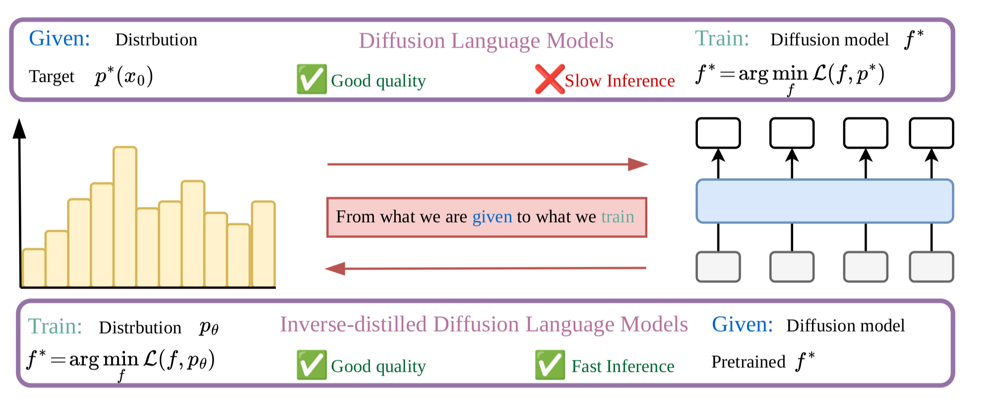

# [IDLM: Inverse-distilled Diffusion Language Models](https://david-cripto.github.io/idlm-project-page/)

<p align="center">
  <strong>By</strong><br>
  <a href="https://david-cripto.github.io/Bio-page/">David Li</a>*,
  <a href="https://scholar.google.com/citations?hl=en&amp;oi=ao&amp;user=UaRTbNoAAAAJ">Nikita Gushchin</a>*,
  <a href="https://scholar.google.com/citations?hl=en&amp;oi=ao&amp;user=h0oeoJkAAAAJ">Dmitry Abulkhanov</a>,
  <a href="https://scholar.google.com/citations?hl=en&amp;oi=ao&amp;user=_XE1LvQAAAAJ">Eric Moulines</a>,
  <a href="https://scholar.google.com/citations?hl=en&amp;oi=ao&amp;user=5kMqBQEAAAAJ">Ivan Oseledets</a>,
  <a href="https://scholar.google.com/citations?hl=en&amp;oi=ao&amp;user=BqDhGJQAAAAJ">Maxim Panov</a>,
  <a href="https://akorotin.netlify.app/">Alexander Korotin</a>
</p>


<p align="center">
  <a href="https://david-cripto.github.io/idlm-project-page/">
    
  </a>

  <a href="https://david-cripto.github.io/Bio-page/blog/idlm/">
    
  </a>
  
  <a href="https://arxiv.org/abs/2602.19066">
    
  </a>
  
  <a href="https://huggingface.co/kekchpek/models">
    
  </a>

  <a href="https://www.youtube.com/watch?v=RZ6_huata1Y&amp;feature=youtu.be">
    
  </a>
  
  <a href="./LICENSE">
    
  </a>
</p>

<div align="center">
  
</div>


## What is IDLM?

Diffusion Language Models can generate high-quality text, but their iterative reverse-diffusion sampling makes inference slow. **IDLM** speeds them up by distilling a pretrained many-step diffusion language model into a **few-step generator**.

Instead of simply matching every teacher step, IDLM uses an [Inverse Distillation](https://arxiv.org/abs/2502.01362) view for discrete token spaces.The paper reports **4×–64× fewer inference steps** while preserving the teacher model’s generation quality.

---

## Repository layout

```text
IDLM/
├── configs/                 # Hydra configs: data, model, algo, strategy, callbacks, etc.
│   ├── algo/                # ar, mdlm, duo, duo_base, d3pm, sedd
│   ├── data/                # OpenWebText and TinyGSM/GSM8K configs
│   │   ├── tiny-gsm.yaml    # TinyGSM training/evaluation data config
│   │   └── gsm8k-test.yaml  # GSM8K/TinyGSM benchmark evaluation config
│   ├── model/               # tiny / small / medium model configs
│   ├── noise/               # diffusion noise schedules
│   └── config.yaml          # main experiment config
├── integral/                # precomputed tokenizer / integration assets, including SmolLM TinyGSM support
├── models/                  # DiT backbone, EMA utilities, attention tests
├── scripts/                 # training and generation recipes
├── algo.py                  # model families and IDLM distillation logic
├── dataloader.py            # tokenizers, OpenWebText/TinyGSM datasets, dataloaders
├── main.py                  # Hydra + Lightning entry point
├── metrics.py               # perplexity, entropy, BPD, NLL metrics
├── trainer_base.py          # shared training / sampling base classes
├── utils.py                 # logging and helper utilities
├── requirements.txt         # environment note / dependency list
└── LICENSE
```

---

## Getting Started
<a name="getting_started"></a>

### Use existing model weights without downloading

Add `model_weights_dir=/absolute/path/to/bundle` to your existing
`python -m main` command. This works on both the OWT and TinyGSM branches.
When supplied, model and tokenizer loaders use local files only and report a
missing asset instead of downloading it. Leaving it unset preserves the normal
loading behavior.

For the OWT bundle, add:

```bash
model_weights_dir=/home/iasudakov/owt_mmd_offline_bundle
```

Keep the usual model IDs in your command:
`eval.checkpoint_path=kuleshov-group/mdlm-owt`,
`adversarial_distill.mmd_ar_model=kuleshov-group/owt-ar`,
`data.tokenizer_name_or_path=gpt2`, and
`eval.gen_ppl_eval_model_name_or_path=gpt2-large`. They resolve to the bundled
MDLM, AR, GPT-2 tokenizer, and GPT-2 Large evaluation assets. Perplexity,
temperature sweeps, and Gradient Moment share the local evaluation model.

For a TinyGSM run with native AR features, add these overrides:

```bash
model_weights_dir=/home/iasudakov/tinygsm_mmd_offline_bundle \
adversarial_distill.mmd_ar_model=checkpoints/tinygsm/ar_notok.ckpt
```

Keep `data.tokenizer_name_or_path=HuggingFaceTB/SmolLM-135M` and set
`training.finetune_path` to your existing local MDLM checkpoint. This TinyGSM
bundle includes the AR checkpoint and both required tokenizers; it does **not**
include the MDLM checkpoint or GPT-2 Large model weights. Evaluation tokenizer
initialization works without those GPT-2 weights; enabling generative
perplexity or Gradient Moment requires a local copy of the evaluation model.

The resolver reads `manifest.json` entries and `hf-cache` snapshots, or model
directories named by repository ID or basename. Explicit absolute model and
checkpoint paths remain supported, including paths outside the bundle. Native
checkpoint paths can be relative to the bundle; existing paths relative to the
launch directory take precedence. Relative bundle paths are resolved before
Hydra changes directories. Quote an override when its path contains spaces.

Tokenizer IDs stay unchanged, preserving vocabulary handling and dataset cache
keys. This option controls model/tokenizer loading; keep configuring your
existing local dataset cache separately.

### 1. Clone the repository

```bash
git clone https://github.com/David-cripto/IDLM.git
cd IDLM
```

### 2. Create an environment

To get started, create a conda environment containing the required dependencies.

```bash
conda create -n idlm python=3.12
conda activate idlm
conda install nvidia/label/cuda-12.4.0::cuda-toolkit
pip install -r requirements.txt
pip install flash_attn==2.7.4.post1
```

---
## Checkpoints
<a name="checkpoints"></a>

* **IDLM-MDLM**. Trained on OpenWebText:
  * [Huggingface](https://huggingface.co/kekchpek/idlm-mdlm)🤗.
* **IDLM-MDLM**. Trained on TinyGSM:
  * [Huggingface](https://huggingface.co/kekchpek/idlm-mdlm-tynigsm)🤗.
* **IDLM-Duo**. Trained on OpenWebText:
  * [Huggingface](https://huggingface.co/kekchpek/idlm-duo)🤗.
* **IDLM-Duo**. Trained on TinyGSM:
  * [Huggingface](https://huggingface.co/kekchpek/idlm-duo-tynigsm)🤗.
* **IDLM-DCD**. Trained on OpenWebText:
  * [Huggingface](https://huggingface.co/kekchpek/idlm-dcd)🤗.

---

## Train IDLM

This section provides reference training entry points for unconditional OpenWebText distillation and conditional TinyGSM distillation. The scripts are written as Hydra override recipes, update the dataset cache and checkpoint paths before launching a run.

### Unconditional OpenWebText Distillation

The OpenWebText recipes train IDLM students for unconditional language generation. Before executing the scripts, configure the `cache_dir` parameter in `configs/data/openwebtext-split.yaml` to specify the desired output path.

#### MDLM teacher → IDLM-MDLM student

```bash
bash scripts/train_idlm_mdlm.sh
```

For OWT MMD distillation, the portable launcher can bias the generator toward
the heavily masked states that matter most at low NFE. This keeps the original
schedule for half of the rows and draws the other half from 70--100% expected
masking:

```bash
OWT_CACHE=/path/to/owt \
HIGH_MASK_FRACTION=0.5 HIGH_MASK_MIN=0.7 HIGH_MASK_MAX=1.0 \
  bash scripts/train_owt_distill.sh
```

The default fraction is zero, so existing runs are unchanged. MMD runs log the
realized whole-sequence fraction as `mmd/generator_mask_fraction`.

An alternative is the [BD3-LMs clipped masking schedule](https://arxiv.org/abs/2503.09573).
`MASK_SCHEDULE=clipped` samples every generator row's masking probability
uniformly inside a fixed interval, preserving stratification across devices
and accumulation steps:

```bash
OWT_CACHE=/path/to/owt MASK_SCHEDULE=clipped MASK_MIN=0.45 MASK_MAX=0.95 \
  bash scripts/train_owt_distill.sh
```

Use `MASK_SCHEDULE=adaptive` to select the interval during validation:

```bash
OWT_CACHE=/path/to/owt MASK_SCHEDULE=adaptive MASK_SEARCH_BATCHES=4 \
  bash scripts/train_owt_distill.sh
```

These options also apply to existing MMD/DMD combination commands. Direct
Hydra equivalents are `adversarial_distill.mask_schedule.mode`, `.min`, `.max`,
and `.search_batches`. Override `.search_intervals` with a list of `[min,max]`
pairs to change the candidates. Adaptive mode starts from `.min`/`.max`, then
chooses the lowest pooled **per-sequence student denoising-loss variance**
over the first few validation batches, with one extra forward per candidate
per batch. This is a BD3-LMs-inspired proxy, not measured MMD gradient variance;
it does not assume that larger masking rates are always better. Sanity checks,
step-zero validation, and standalone evaluation do not update the schedule.
The selected bounds and proxy are logged under `mask_schedule/*` and restored
from checkpoints when the schedule settings match.

The default `original` mode preserves the existing sampler and high-mask
mixture. For `clipped`/`adaptive`, use `HIGH_MASK_FRACTION=0` and disable
`adversarial_distill.generator_force_full_mask`. Only the corruption used to
produce student samples changes, including samples used to train the fake
critic; teacher/fake loss corruption, evaluation NLL, and generation remain
unchanged. Bounds refer to **expected** masking probabilities: mask patterns
are still Bernoulli draws, without blockwise rejection resampling. The
log-linear schedule caps a requested maximum of 1 at 0.999 before drawing.

For sentence-level MMD with the AR critic, add these overrides to an existing
OWT MMD training command to use the **last token's hidden state** instead of
the mean over scored (usually masked) positions:

```bash
adversarial_distill.mmd_reward_type=feature \
adversarial_distill.mmd_feature_source=ar \
adversarial_distill.mmd_kernel_level=sentence \
adversarial_distill.mmd_sentence_pooling=last_token
```

On packed OWT this reads position `model.length - 1`, even if it was not
masked; it does not read the last masked token or stop at an internal EOS.
The critic still processes the full sequence, so a contextual AR layer's final
hidden state can represent changes earlier in the sequence. Layer `-1` is only
the input embedding and cannot summarize the prefix; the default middle block
is contextual.

Keep your existing kernel/source/draw-count settings. This option works with
both `rows` and `draws` under their existing kernel restrictions (for example,
`pseudo_huber` still requires `draws`). Estimators and loss normalization are
unchanged: sentence `draws` still uses the unbiased fake-pair correction for
K > 1 and the biased fallback for K = 1. `mmd_score_positions` does not move
the last-token readout, and only masked/written positions carry the REINFORCE
gradient. Omit the new option or set `mmd_sentence_pooling=mean` to retain the
previous behavior. Diffusion features and token-level kernels do not support
`last_token`.

To use cosine similarity as the MMD kernel, change only the kernel in your
feature-reward command (keep its existing source, level, K, G and pooling):

```bash
adversarial_distill.mmd_reward_type=feature \
adversarial_distill.mmd_kernel=cosine
```

This computes MMD with `k(x,y) = dot(normalize(x), normalize(y))`, using L2
normalization in float32. At token level each token vector is normalized
individually; at sentence level the existing mean/last-token readout happens
first, and that sentence vector is normalized. It is **not** cosine similarity
between two final pooled means and does not apply pseudo-Huber. It supports
both AR and diffusion features (the `last_token` readout remains AR-only).

Self-pair removal and activity rules follow RBF: token comparisons need at
least two scored vectors on each side; sentence `rows` needs K >= 2. Sentence
`draws` treats the observed real vector as fixed, removes fake self-pairs at
K > 1, and uses a biased squared distance between normalized vectors at K = 1
(`2 * (1 - cosine)` for nonzero unit vectors). Zero vectors are handled with
epsilon-safe normalization and their actual diagonal kernel values. Negative
finite-sample MMD estimates are retained. No bandwidth is needed;
`mmd_rbf_alpha` and `mmd_rbf_block_size` do not affect this kernel.

Cosine is a linear kernel on unit features, so its population MMD only matches
their **mean**, unlike RBF's nonlinear comparison. Removing feature magnitude
therefore also changes the objective's sensitivity; an RBF kernel applied to
unit-normalized features would be a different experiment (not enabled by this
option). Existing `linear`, `rbf`, and `pseudo_huber` behavior and the REINFORCE
`G*K`/token loss normalization are unchanged. Cosine uses a dot-product sum,
not an extra `1/hidden_dim` average; reward scales need not match the prior run.
Test it as a fresh run rather than resuming and mixing kernel histories.

#### DUO teacher → IDLM-Duo student

```bash
bash scripts/train_idlm_duo.sh
```

#### DCD teacher → IDLM-DCD student

```bash
bash scripts/train_idlm_dcd.sh
```

### Conditional TinyGSM Distillation

The TinyGSM recipes train IDLM students for conditional mathematical reasoning on TinyGSM-style question-answer examples. Before executing the scripts, configure `cache_dir` in `configs/data/tiny-gsm.yaml` and replace the `training.finetune_path` placeholder in each script with the corresponding pretrained teacher checkpoint. Our TinyGSM distillation runs use the teacher checkpoints from the [S-FLM repository](https://github.com/jdeschena/s-flm): [MDLM](https://huggingface.co/jdeschena/s-flm/blob/main/tinygsm/mdlm.ckpt) for IDLM-MDLM and [Duo](https://huggingface.co/jdeschena/s-flm/blob/main/tinygsm/duo.ckpt) for IDLM-Duo.

#### MDLM teacher → IDLM-MDLM TinyGSM student

```bash
bash scripts/train_idlm_mdlm_tynigsm.sh
```

#### DUO teacher → IDLM-Duo TinyGSM student

```bash
bash scripts/train_idlm_duo_tynigsm.sh
```

---

## Evaluation

This section separates unconditional OpenWebText generation from conditional TinyGSM benchmark evaluation.

### Unconditional OpenWebText Evaluation

The generation scripts sweep over 4, 8, 16, and 32 sampling steps.

Before running them, set `eval.generated_samples_path` to a real JSON output path.

#### IDLM-MDLM checkpoint

```bash
mkdir -p samples

python -m main \
  mode=sample_eval \
  loader.batch_size=2 \
  loader.eval_batch_size=8 \
  data=openwebtext-split \
  algo=mdlm \
  algo.backbone=hf_dit \
  eval.checkpoint_path=kekchpek/idlm-mdlm \
  sampling.steps=16 \
  sampling.num_sample_batches=10 \
  sampling.predictor=ancestral_cache \
  sampling.noise_removal=ancestral \
  +wandb.offline=true \
  eval.generated_samples_path=samples/idlm_mdlm_16steps.json
```

#### IDLM-Duo checkpoint

```bash
mkdir -p samples

python -m main \
  mode=sample_eval \
  loader.batch_size=2 \
  loader.eval_batch_size=8 \
  data=openwebtext-split \
  algo=duo \
  algo.backbone=hf_dit \
  eval.checkpoint_path=kekchpek/idlm-duo \
  sampling.steps=16 \
  sampling.num_sample_batches=10 \
  sampling.noise_removal=greedy \
  +wandb.offline=true \
  eval.generated_samples_path=samples/idlm_duo_16steps.json
```

#### IDLM-DCD checkpoint

```bash
mkdir -p samples

python -m main \
  mode=sample_eval \
  loader.batch_size=2 \
  loader.eval_batch_size=8 \
  data=openwebtext-split \
  algo=duo \
  algo.backbone=hf_dit \
  eval.checkpoint_path=kekchpek/idlm-dcd \
  sampling.steps=4 \
  sampling.num_sample_batches=10 \
  sampling.noise_removal=greedy \
  +wandb.offline=true \
  eval.generated_samples_path=samples/idlm_duo_4steps.json
```

#### Run the provided scripts

```bash
bash scripts/generation_idlm_mdlm.sh
bash scripts/generation_idlm_duo.sh
bash scripts/generation_idlm_dcd.sh
```

Generated sample files contain:

```json
{
  "generative_ppl": 0.0,
  "entropy": 0.0,
  "generated_seqs": []
}
```

### Conditional TinyGSM Evaluation

We release the TinyGSM IDLM checkpoints on Hugging Face: [IDLM-MDLM TinyGSM](https://huggingface.co/kekchpek/idlm-mdlm-tynigsm) and [IDLM-Duo TinyGSM](https://huggingface.co/kekchpek/idlm-duo-tynigsm). To evaluate these conditional models on the TinyGSM benchmark, use the `.ckpt` files from the Hugging Face repositories together with the TinyGSM evaluation code from the [S-FLM repository](https://github.com/jdeschena/s-flm).

---

## Outputs

By default, Hydra writes experiment outputs under:

```text
outputs/<dataset>/<date>/<time>/
```

TensorBoard logs are written under:

```text
tb_logs/
```

Checkpoints are written according to the checkpointing config in `configs/config.yaml`.

---

## Citation

If you find this repository useful, please cite:

```bibtex
@article{li2026idlm,
  title={IDLM: Inverse-distilled Diffusion Language Models},
  author={Li, David and Gushchin, Nikita and Abulkhanov, Dmitry and Moulines, Eric and Oseledets, Ivan and Panov, Maxim and Korotin, Alexander},
  journal={arXiv preprint arXiv:2602.19066},
  year={2026}
}
```

---

## Acknowledgements

Our codebase is inspired by recent Discrete Diffusion Models projects. Namely, [MDLM](https://github.com/kuleshov-group/mdlm), [Duo](https://github.com/s-sahoo/duo), and [S-FLM](https://github.com/jdeschena/s-flm).

---

## License

This project is released under the MIT License. See [`LICENSE`](LICENSE) for details.
